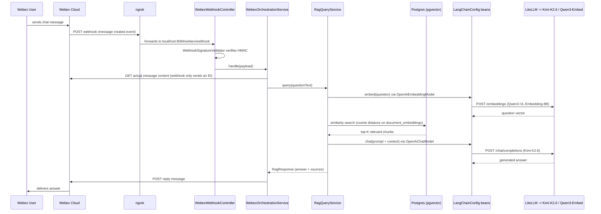
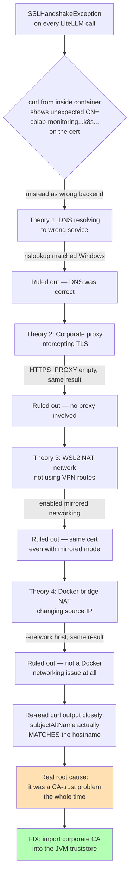
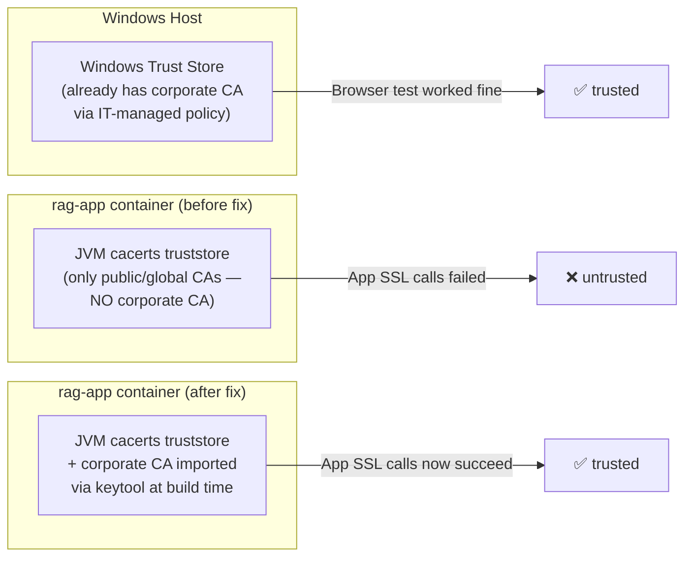

# Telecom Knowledge Assistant — Technical Summary

A complete reference for understanding the architecture, the network/SSL issue we resolved, redeployment procedures, and improvement ideas.

---

## 1. Complete Architecture

## Architecture

```
┌─────────────────────────────────────────────────────────────────┐
│                         REST API (Spring Boot)                   │
│  POST /api/documents/upload   POST /api/documents/url           │
│  POST /api/query                                                  │
└────────────────────┬──────────────────────┬─────────────────────┘
                     │                      │
          ┌──────────▼──────────┐  ┌────────▼──────────┐
          │  IngestionService   │  │  RagQueryService   │
          │                     │  │                    │
          │ 1. Load document    │  │ 1. Embed question  │
          │ 2. Split to chunks  │  │ 2. Search pgvector │
          │ 3. Embed chunks     │  │ 3. Build prompt    │
          │ 4. Store pgvector   │  │ 4. Call llama3     │
          └──────────┬──────────┘  └────────┬───────────┘
                     │                      │
          ┌──────────▼──────────────────────▼───────────┐
          │            Ollama  (localhost:11434)          │
          │   • qwen3			  (embeddings)            │
          │   • kimi	            (generation)          │
          └──────────────────────────────────────────────┘
                     │
          ┌──────────▼──────────────────────────────────┐
          │         PostgreSQL 16 + pgvector              │
          │   document_embeddings  (vectors + text)       │
          │   document_records     (metadata)             │
          └─────────────────────────────────────────────-┘
```


### 1.1 High-level component map

```mermaid
flowchart LR
    subgraph Webex Cloud
        WX[Webex Messaging API]
    end

    subgraph "Docker Compose Stack (your machine)"
        NGROK[ngrok tunnel<br/>public HTTPS -> localhost:8084]
        APP[rag-app<br/>Spring Boot :8084]
        PG[(rag-postgres-webex<br/>Postgres + pgvector :5432)]
        PGADMIN[pgAdmin UI :80]
    end

    subgraph External LLM (LiteLLM proxy)
        LITELLM[LiteLLM Gateway<br/>litellm.ai.netcracker.cloud]
        KIMI[Kimi-K2.6 - chat]
        QWEN[Qwen3-VL-Embedding-8B - embeddings]
    end

    USER[Webex user] -- sends message --> WX
    WX -- webhook POST --> NGROK
    NGROK --> APP
    APP -- fetch message content --> WX
    APP -- similarity search / store --> PG
    APP -- chat + embedding calls --> LITELLM
    LITELLM --> KIMI
    LITELLM --> QWEN
    APP -- reply --> WX
    WX -- delivers reply --> USER
    PGADMIN -.admin UI.-> PG
```

### 1.2 Java package structure (as built)

```
com.rag
├── RagApplication.java                    Spring Boot entry point
│
├── config/
│   └── LangChainConfig.java               Chat + Embedding model beans (OpenAiChatModel /
│                                           OpenAiEmbeddingModel, pointed at LiteLLM)
│
├── controller/
│   ├── QueryController.java               POST /api/query        -> ask a question directly
│   └── IngestionController.java           POST /api/documents/upload   -> upload file (PDF/DOCX/XLSX/TXT)
│                                           POST /api/documents/url      -> ingest a web page
│                                           GET  /api/documents          -> list ingested docs
│                                           DELETE /api/documents/{id}   -> delete a doc record
│
├── document/
│   ├── DocumentLoaderService.java         Parses uploaded files into text chunks
│   └── DocumentType.java                  Enum: PDF, DOCX, XLSX, TXT, URL
│
├── model/
│   └── DocumentRecord.java                JPA entity — metadata about each ingested document
│
├── repository/
│   └── DocumentRepository.java            Spring Data repository for DocumentRecord
│
├── service/
│   ├── IngestionService.java              Orchestrates: load -> chunk -> embed -> store in pgvector
│   └── RagQueryService.java                Orchestrates: embed question -> similarity search ->
│                                           build prompt with retrieved context -> call chat model
│
└── webex/
    ├── config/WebexConfig.java            Webex RestTemplate + API base URL config
    ├── controller/
    │   ├── WebexWebhookController.java    POST /webex/webhook — receives Webex's webhook callbacks
    │   └── WebhookAdminController.java    POST /webex/admin/register-webhook — one-time webhook
    │                                       registration helper (safe to delete after first use)
    ├── dto/                               WebexMessage, WebexOutboundMessage, WebexWebhookPayload
    ├── service/
    │   ├── WebexOrchestrationService.java Glue: receives webhook -> fetches message -> calls
    │   │                                   RagQueryService -> sends reply back via WebexService
    │   └── WebexService.java              Low-level Webex API client (get message, send message)
    └── util/WebhookSignatureValidator.java Verifies X-Spark-Signature HMAC to confirm the webhook
                                            genuinely came from Webex
```

### 1.3 Request flow — Webex question end-to-end



### 1.4 Ingestion flow

```
Upload (PDF/DOCX/XLSX/TXT or URL)
        │
        ▼
IngestionController → IngestionService
        │
        ▼
DocumentLoaderService — extract & chunk text
        │
        ▼
OpenAiEmbeddingModel (Qwen3-VL-Embedding-8B via LiteLLM) — embed each chunk
        │
        ▼
pgvector "document_embeddings" table — store vector + text + metadata
        │
        ▼
DocumentRepository — store DocumentRecord (filename, type, ingested-at, etc.)
```

### 1.5 Tech stack

| Layer | Technology |
|---|---|
| Language / Runtime | Java 21, Spring Boot 3.3.4 |
| AI orchestration | LangChain4j 0.35.0 (`langchain4j-open-ai` module) |
| LLM access | LiteLLM proxy (OpenAI-compatible gateway) → Kimi-K2.6 (chat), Qwen3-VL-Embedding-8B (embeddings) |
| Vector store | PostgreSQL 16 + `pgvector` extension, 4096-dim vectors |
| Messaging channel | Cisco Webex (webhook-based) |
| Tunneling | ngrok (exposes local app publicly for Webex's webhook callback) |
| Containerization | Docker / Rancher Desktop (WSL2 backend) |
| DB admin | pgAdmin4 |
| Build | Maven |

---

## 2. The Network/SSL Issue — What Happened and How It Was Fixed

### 2.1 The symptom

```
javax.net.ssl.SSLHandshakeException: (certificate_unknown) PKIX path building failed:
sun.security.provider.certpath.SunCertPathBuilderException: unable to find valid
certification path to requested target
```

This fired every time `rag-app` (inside Docker) tried to call `litellm.ai.netcracker.cloud`.

### 2.2 The diagnostic journey (and where it went briefly sideways)



### 2.3 The actual root cause

`litellm.ai.netcracker.cloud` uses a certificate issued by your **company's internal Certificate Authority** ("xxxxxx Technology CA"), not a public CA like Let's Encrypt or DigiCert. Two separate trust stores were involved, and only one had that internal CA installed:



The certificate itself was **correct the whole time** — it's a wildcard cert (`*.ai.netcracker.cloud`) whose primary Common Name happens to be a different internal service (`cblab-monitoring...`), which is normal for a shared wildcard certificate and is *not* a sign of hitting the wrong backend. `curl`'s own `subjectAltName ... matches` line confirmed this the entire time — it was misread as a mismatch early in the debugging process, which led to several unnecessary detours through DNS, proxy, and WSL/Docker network theories before returning to the original, correct diagnosis: **an untrusted internal CA in the JVM's trust store.**

### 2.4 The fix — 3 pieces

1. **Export the corporate CA certificate** from Windows (`certmgr.msc` → Trusted Root CAs → export as Base-64 `.cer`)
2. **Place it in the project**: `certs/corporate-ca.crt.cer`
3. **Import it into the JVM truststore at Docker build time** (added to `Dockerfile`):
   ```dockerfile
   COPY certs/corporate-ca.crt.cer /tmp/corporate-ca.crt
   RUN keytool -importcert -trustcacerts -noprompt \
       -alias corporate-ca \
       -file /tmp/corporate-ca.crt \
       -keystore "$JAVA_HOME/lib/security/cacerts" \
       -storepass changeit \
       && rm /tmp/corporate-ca.crt
   ```

### 2.5 Key lesson for next time

When you see `unable to get local issuer certificate` / `PKIX path building failed`, treat it first as a **trust-store problem** (fix: import the CA), not a routing/DNS problem — routing issues produce *connection* failures (timeouts, connection refused, wrong host unreachable), whereas trust-store issues produce a **successful connection that then fails certificate verification**, which is exactly what was happening here from the very first error message.

---

## 3. Rebuild & Deploy — What Needs What

| You changed... | What you need to do |
|---|---|
| `.env` values only (API keys, model names, URLs) | `docker compose up -d` — no rebuild needed, just restart with new env vars picked up |
| `application.yml` | **Rebuild required** — it's baked into the jar. `docker compose up -d --build app` |
| Any `.java` file | **Rebuild required.** `docker compose up -d --build app` |
| `Dockerfile` (e.g. cert import step) | **Rebuild required**, and use `--no-cache` if the change is early in the layer stack (like a `COPY`/`RUN` near the top) to guarantee it re-executes: `docker compose build app --no-cache && docker compose up -d app` |
| `docker-compose.yml` (ports, env var names, service definitions) | Requires **recreation**, not just restart: `docker compose up -d --force-recreate <service>` |
| `certs/corporate-ca.crt.cer` (new/rotated cert) | Rebuild the `app` image (cert import happens at build time) |
| Nothing — just want a clean restart | `docker compose restart app` (fastest, no rebuild) |

### Full clean rebuild (when in doubt / something's behaving strangely)
```powershell
docker compose down
docker compose build --no-cache
docker compose up -d
```

### Quick reference: config-only vs full rebuild
- **Config-only** (fast): env vars in `.env` that map to `${VAR}` placeholders already in `application.yml`/`docker-compose.yml`
- **Full rebuild** (slower): anything that changes compiled code, the jar's embedded config defaults, or the Docker image layers themselves (Dockerfile, cert files, pom.xml dependencies)

### Resetting pgvector data (only when the embedding dimension changes)
```powershell
docker compose down -v      # -v wipes the Postgres volume — all ingested documents are lost
docker compose up -d postgres
# re-ingest all documents afterward
```

---

## 4. Suggested Improvements

### Reliability / operability
- **Automate webhook re-registration** — ngrok's free tier issues a new URL every restart, breaking the Webex webhook silently. Add a startup hook that calls `WebhookAdminController`'s logic automatically on app boot, or move to a paid ngrok static domain / a real public hostname for anything beyond local dev.
- **Health check for the `app` service** in `docker-compose.yml` (it currently has none — `postgres` does) so `docker compose ps` accurately reflects readiness, and `ngrok`'s `depends_on` can wait for a true health signal instead of just "container started."
- **Fail-fast, visible startup diagnostics** — right now a missing env var surfaces as a deep Spring bean-creation stack trace. A custom `@PostConstruct` validation in `LangChainConfig` that checks required properties and logs one clear message (`"LLM_CHAT_API_KEY is not set — check your .env file"`) would save significant debugging time.
- **Secrets hygiene** — `.env` currently holds live tokens in plaintext (Webex bot token, ngrok authtoken). Worth moving to a proper secrets manager (Docker secrets, Vault, or at minimum ensuring `.env` is gitignored and rotated periodically).

### RAG quality
- **Chunking strategy review** — check `DocumentLoaderService`'s chunk size/overlap; tune based on how Kimi-K2.6 performs with your actual document types.
- **Re-ranking step** — add a re-ranker between the pgvector similarity search and the final prompt, since raw cosine similarity alone often surfaces marginally-relevant chunks.
- **Citation/source display in Webex replies** — `RagResponse` already seems to carry source info; surfacing which document(s) an answer came from directly in the Webex message would build user trust.
- **Embedding dimension truncation (MRL)** — Qwen3 embedding models support Matryoshka truncation (e.g. using fewer than the full 4096 dims) for faster search/less storage at a small accuracy cost — worth benchmarking if pgvector query latency becomes a concern at scale.

### Observability
- **Structured logging around the LLM call boundary** — timing, token counts, and model name on every request, so you can track latency/cost over time.
- **A `/health/llm` endpoint** that pings LiteLLM directly, so you can distinguish "app is up" from "LLM backend is reachable" at a glance — would have made this entire debugging session much faster.

### Developer experience
- **`docker compose config` as a documented first troubleshooting step** — as we learned firsthand, most of the config-layer bugs we hit (missing API keys, malformed base URLs) would have been caught instantly by checking resolved config before starting the app.
- **A seed/smoke-test script** — one command that ingests a small sample doc and asks it a known question, to verify end-to-end health after any redeploy without needing Webex in the loop.

---

## Appendix — Commands you'll use most often

```powershell
# Full status check
docker compose ps -a

# Live app logs
docker logs -f rag-app

# Resolved config (catches most env-var bugs immediately)
docker compose config | Select-String "LLM_"

# Rebuild just the app
docker compose up -d --build app

# Test the RAG pipeline directly, bypassing Webex
curl -X POST http://localhost:8084/api/query -H "Content-Type: application/json" -d '{"question":"your test question"}'

# Check ingested document count
# (run in DBeaver, connected to localhost:5435 / db "ragdb")
SELECT COUNT(*) FROM document_embeddings;
```

## API Reference

### Ingest a PDF / DOCX / Excel / TXT file

```bash
curl -X POST http://localhost:8080/api/documents/upload \
  -F "file=@/path/to/document.pdf"
```
